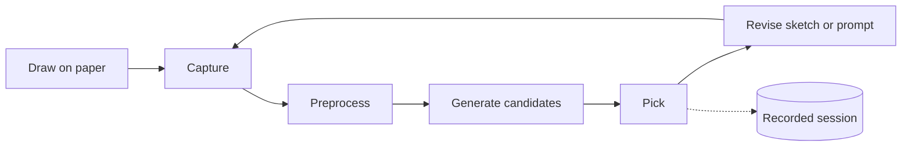
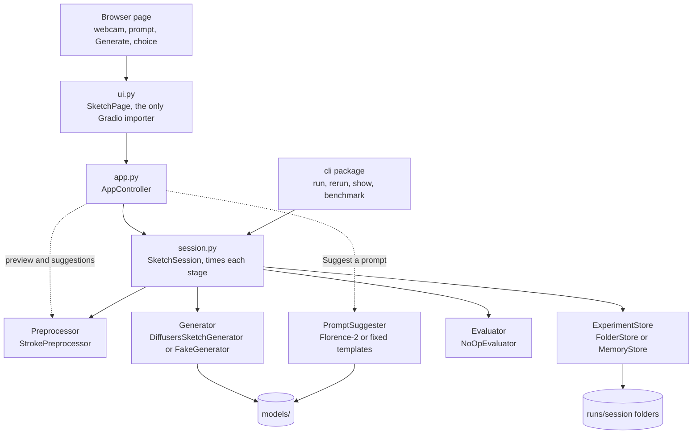

# SketchLoop AI

[](https://github.com/shlomi1993/sketchloop-ai/actions/workflows/checks.yml)


**Draw on paper, get AI alternatives, pick what you like, and draw again.**

SketchLoop is a modular Python research library, with a browser page and a command line, for iterative design with physical sketches and generative AI. A camera or image file supplies the sketch, Stable Diffusion with ControlNet generates candidates that follow its lines, and the person explicitly chooses among them before the next round. Every round is recorded, so a session can be reopened, inspected, and rerun later.



## Contents

- [Features](#features)
- [Quick start](#quick-start)
- [Using the browser page](#using-the-browser-page)
- [Using the command line](#using-the-command-line)
- [Configuration](#configuration)
- [Using it as a library](#using-it-as-a-library)
- [Architecture](#architecture)
- [Development](#development)
- [Project status](#project-status)
- [Documentation](#documentation)
- [Troubleshooting](#troubleshooting)

## Features

- **Sketch input:** a live webcam, an uploaded image, or a PNG or JPEG file.
- **Preprocessing:** finds the paper, corrects perspective and tilt, crops to the strokes, normalizes contrast, and resizes to 512 px. The raw image is always kept.
- **Real generation:** Stable Diffusion 1.5 with ControlNet scribble, in a `fast` mode (LCM-LoRA, 4 steps) or a `quality` mode (20 steps), on CUDA, Apple MPS, or the CPU.
- **Offline prompt suggestions:** a local Florence-2 model names the sketched object and proposes style prompts. No cloud service is involved.
- **Human choice:** candidates are only suggestions. The person records an explicit selection, or none, each round.
- **Experiment records:** each round saves its sketches, candidates, prompt, effective settings, seeds, checksums, stage timings, hardware, and selection, linked to the previous round.
- **Replay:** reopen a saved session and rerun a round as a new linked session, with an honest report of what came out identical.
- **Replaceable parts:** capture, preprocessing, generation, evaluation, and storage sit behind abstract base classes and are chosen in a settings file.
- **Offline tests:** the default checks need no camera, GPU, network, or model weights, thanks to a labeled fake backend.

## Quick start

### Requirements

- Python 3.11 or newer.
- Network access for the first install, and about 6 GB of disk for the real models.
- Optional: a webcam, and a GPU (NVIDIA or Apple Silicon) for faster generation.

### 1. Install

```sh
git clone https://github.com/shlomi1993/sketchloop-ai.git
cd sketchloop-ai
python3 install.py && . .venv/bin/activate
```

On Windows, run `py -3 install.py` and then `.venv\Scripts\Activate.ps1`.

The installer creates or reuses `.venv`, installs the package with its development tools, runs `pip check`, and runs two quick readiness tests. It cannot activate the environment in your terminal by itself, which is why the command above chains the activation.

### 2. Try it without a model

```sh
sketchloop ui
```

This opens a local page, usually at <http://127.0.0.1:7860>, with the fake backend. The fake makes clearly labeled noise images, so you can explore the whole workflow in seconds before downloading anything.

### 3. Use the real model

```sh
python scripts/download_models.py
sketchloop ui --backend diffusers
```

The download script fetches about 6 GB into the git-ignored `models/` folder and skips files already present. To make the real model the default, copy [examples/sketchloop.toml](examples/sketchloop.toml) to `sketchloop.toml`, which already sets `backend = "diffusers"`. After that, plain `sketchloop` opens the page with the real model.

## Using the browser page

Run `sketchloop`, which is short for `sketchloop ui`. The page is served on 127.0.0.1 only, with no share link and Gradio analytics off.

1. **Sketch:** the webcam starts streaming by itself, or switch to uploading a PNG or JPEG. The page shows the sketch the model will receive, refreshed every 0.5 s and preprocessed unless raw is ticked. Clockwise rotation turns the input, 180 degrees by default for the webcam.
2. **Direction:** type a prompt, or press **Suggest a prompt**. Pressing it again for the same drawing gives the next style. Set the steps and the other generation sliders, the seed, and the number of candidates.
3. **Choose:** click **Generate**, tick the candidates you like, or none, and click **Record selection**. Then change the drawing or the prompt and generate the next round.

The page lists the current session's history, and **New session** starts a fresh session with the model still loaded. All browser tabs share one session, and reloading the page keeps it.

| Option | Default | Meaning |
| --- | --- | --- |
| `--backend` | `fake` | `fake` or `diffusers` |
| `--mode` | `fast` on CPU, `quality` on a GPU | Diffusers sampling mode |
| `--precision` | `float16` on a GPU, `float32` on CPU | Diffusers precision, and the CPU cannot use float16 |
| `--candidates` | 1 | Starting number of candidates per round |
| `--seed` | random | Starting base seed |
| `--capture-interval` | 0.5 | Seconds between the webcam frames the page keeps |
| `--runs-dir` | `runs` | Where sessions are saved |
| `--config` | `./sketchloop.toml` if present | Settings file |

## Using the command line

| Command | What it does |
| --- | --- |
| `sketchloop run SKETCH --prompt TEXT` | Run rounds in the terminal from an image file |
| `sketchloop run --camera --prompt TEXT` | Same, capturing from a webcam |
| `sketchloop show runs/SESSION` | Print a saved session and check its files, without loading a model |
| `sketchloop rerun runs/SESSION --round N` | Repeat a round as a new linked session |
| `sketchloop benchmark SKETCH --prompt TEXT` | Time repeated rounds and report statistics per stage |
| `sketchloop ui` | Open the browser page, also the default with no command |

Run any command with `--help` for all its options. `run`, `ui`, and `benchmark` share `--backend`, `--mode`, `--precision`, `--seed`, `--candidates`, and `--runs-dir`.

### Run rounds in the terminal

```sh
sketchloop run examples/sketch-photo.jpg --prompt "modern chair"
```

This generates four candidates by default and asks you to pick some by number. Add `--raw` to generate from the unprocessed image, or `--rotate 90` to turn it first. With `--camera`, a preview window opens, Space captures, and Esc cancels, and `--camera-index 1` picks a second camera.

After each pick, a menu starts the next round with the model still loaded:

| Key | Action |
| --- | --- |
| Enter | Repeat with the same sketch and prompt |
| `p` | Enter a new prompt |
| `c` | Recapture from the camera, with `--camera` |
| `f PATH` | Load another sketch file |
| `q` | Quit and print a summary |

Each round prints how long every stage took (capture, preprocessing, model load, generation, evaluation, and saving), the total, and the CPU, cores, and memory it ran on.

### Inspect and rerun a session

```sh
sketchloop show runs/<session>
sketchloop rerun runs/<session> --round 1
```

`show` prints the records and lists missing or changed files. `rerun` recreates the backend and settings from the recorded round, generates from the stored `sketch.png`, and reports which candidates came out byte-identical and what changed in the environment. It never claims exact replay when the backend cannot guarantee it.

### Benchmark

```sh
sketchloop benchmark examples/sketch-photo.jpg --prompt "modern chair" --rounds 5 --warmup 1
```

The benchmark runs the warm-up rounds and then the measured rounds with one loaded backend, records no selection, and prints the median, p95, minimum, and maximum of every stage and the total. It uses seed 0 unless one is given. With fewer than 20 measured rounds, the p95 is only indicative. See [the latency baseline](docs/results/t08-latency-baseline.md) for measured numbers.

### What a session folder holds

```text
runs/<session>/
├── session.json        # Environment, package versions, hardware, and generator setup time
└── round-1/
    ├── round.json      # Request, effective settings, seeds, checksums, timings, and selection
    ├── sketch-raw.jpg  # The original file or capture
    ├── sketch.png      # The preprocessed sketch the model received
    └── candidates/     # One image per candidate
```

The full record contract is in [EXPERIMENTS.md](docs/EXPERIMENTS.md).

## Configuration

Instead of repeating flags, copy [examples/sketchloop.toml](examples/sketchloop.toml), which lists every key, to `sketchloop.toml` in the folder you run from. Git ignores that file. You can also pass `--config PATH` to `run`, `ui`, or `rerun`.

```toml
[generator]
backend = "diffusers"  # fake or diffusers

[generator.diffusers]
mode = "fast"          # fast or quality
models_dir = "models"  # also read by scripts/download_models.py

[storage]
runs_dir = "runs"
```

- **Precedence:** a command-line flag overrides the file, and the file overrides the built-in default.
- **Scope:** the file chooses the backend, mode, and precision, the image source for `run`, the preprocessor, the evaluator, the store and its runs folder, and the default candidates and seed for `run` and `ui`.
- **Paths:** a relative `runs_dir` or `models_dir` is relative to the file's folder. Run `scripts/download_models.py` with the same file, so it downloads where the backend looks.
- **Feedback:** a command that uses a file first prints `Settings:` with its path, and a bad value exits with one line naming the key.
- **Rerun:** `rerun` takes only the store, evaluator, and models folder from the file, and everything else from the recorded round.

## Using it as a library

The workflow does not depend on the UI. This runs one round with the fake backend and records a choice:

```python
from pathlib import Path

from sketchloop.backends import make_generator
from sketchloop.capture import load_sketch_file
from sketchloop.domain import GenerationBackend, Guidance, SelectionEvent, SketchSource
from sketchloop.experiments.stores import FolderStore
from sketchloop.session import SketchSession

session = SketchSession(make_generator(GenerationBackend.FAKE), FolderStore(Path("runs")))
raw_sketch, payload = load_sketch_file(Path("examples/sketch-photo.jpg"))
outcome = session.run_round(raw_sketch, payload, Guidance(prompt="modern chair"), source=SketchSource.FILE, n_candidates=2)
candidates = outcome.iteration.result.candidates
session.record_selection(SelectionEvent(iteration_id=outcome.iteration.id, selected_candidate_ids=(candidates[0].id,)))
print(outcome.folder)
```

Replace any part by subclassing its base class: `Generator`, `Preprocessor`, `Evaluator`, `ExperimentStore`, or `CaptureSource`. See [ARCHITECTURE.md](docs/ARCHITECTURE.md) and [ADR 0014](docs/decisions/0014-replaceable-components-and-settings.md).

## Architecture

Each layer calls only the one below it. The page never touches the model or the files, and the session knows only the base classes, whose implementations the settings file picks.



The [full call graph](docs/call-graph.html) shows every handler and method. Open it in a browser after cloning.

### Models

| Model | Role | License |
| --- | --- | --- |
| [Stable Diffusion 1.5](https://huggingface.co/stable-diffusion-v1-5/stable-diffusion-v1-5) | Base image generator | CreativeML OpenRAIL-M |
| [ControlNet scribble](https://huggingface.co/lllyasviel/control_v11p_sd15_scribble) | Makes the image follow the sketch's lines | CreativeML OpenRAIL-M |
| [LCM-LoRA](https://huggingface.co/latent-consistency/lcm-lora-sdv1-5) | Cuts sampling to 4 steps in `fast` mode | OpenRAIL++ |
| [Florence-2-base](https://huggingface.co/florence-community/Florence-2-base) | Names the sketched object for prompt suggestions | MIT |

The choices are explained in [ADR 0009](docs/decisions/0009-diffusers-backend.md) and [ADR 0019](docs/decisions/0019-offline-prompt-suggestions.md). On an Apple M2 Pro in float16, a 2-candidate round takes about 5 s in `fast` mode and 23 s in `quality` mode. On a laptop CPU, one fast image takes about 100 s.

### Repository layout

```text
src/sketchloop/   Library: domain records, capture, preprocessing, backends, session, experiments, cli, app, ui
tests/            Offline pytest suite, mirroring src/
scripts/          check.py, download_models.py, dev_ui.py, and the privacy guard
examples/         Sample sketches and a settings file with every key
docs/             Specification, architecture, roadmap, status, ADRs, research notes, and results
models/, runs/    Downloaded weights and saved sessions, both git-ignored
```

## Development

| Command | Purpose |
| --- | --- |
| `python scripts/check.py` | Full offline check: privacy guard, syntax, TOML, Markdown links, Ruff, and pytest |
| `python -m pytest` | Offline tests only |
| `python -m pytest -m model` | Real-model test, which needs the downloaded weights |
| `python scripts/dev_ui.py` | Serve the page with live reload while editing it |

`dev_ui.py` loads the model once and rebuilds the page whenever a `.py` or `.css` file under `src/sketchloop` is saved. Changes to the controller or model code still need a restart.

CI runs the full check on Python 3.11 and 3.12 for every push and pull request, with CPU-only torch and no model weights. The [development guide](docs/DEVELOPMENT.md) covers the installer, checks, and conventions in depth.

### Working with coding agents

[AGENTS.md](AGENTS.md) is the working agreement for every coding agent, covering invariants, code style, and the commit process. Claude Code loads it through [CLAUDE.md](CLAUDE.md), which adds role subagents in `.claude/agents/` and skills such as `/start-task` and `/handoff`. Agents start each session from [docs/STATUS.md](docs/STATUS.md).

### Privacy

The original research proposal is private and deliberately excluded from Git. Everything needed to develop the project is in `docs/`. Read [PRIVACY.md](docs/PRIVACY.md) before committing, and never commit captured sketches, participant data, or credentials.

## Project status

| Task | Outcome | Status |
| --- | --- | --- |
| T01 | Typed contracts, the fake backend, and the `sketchloop` command | ✅ Done |
| T02 | Image and webcam input with preprocessing | ✅ Done |
| T03 | Real generation with SD 1.5 and ControlNet scribble | ✅ Done |
| T04 | Several manual rounds in one session | ✅ Done |
| T05 | Session records, `show`, and `rerun` | ✅ Done |
| T06 | Local browser page | ✅ Done |
| T07 | Replaceable components and `sketchloop.toml` | ✅ Done, tested offline |
| T08 | Stage timings, hardware records, and `benchmark` | ✅ Done |
| T09 | Full demo and evaluation report | ⬜ Planned |
| T10 | Contingency | ⬜ Planned |

Page improvements from the owner's feedback are tracked as U1 to U4 in the [roadmap](docs/ROADMAP.md). The current state and next action are in [STATUS.md](docs/STATUS.md).

## Documentation

| Document | Contents |
| --- | --- |
| [PROJECT.md](docs/PROJECT.md) | Requirements R01 to R10 and acceptance criteria |
| [ARCHITECTURE.md](docs/ARCHITECTURE.md) | Components, boundaries, and interfaces |
| [EXPERIMENTS.md](docs/EXPERIMENTS.md) | The experiment record contract |
| [ROADMAP.md](docs/ROADMAP.md) | Tasks, their evidence, and open decisions |
| [STATUS.md](docs/STATUS.md) | Current state and the next action |
| [decisions/](docs/decisions/) | Architecture decision records |
| [DEVELOPMENT.md](docs/DEVELOPMENT.md) | Setup, checks, and conventions |
| [REFERENCES.md](docs/REFERENCES.md) | Research papers and citations |
| [PRIVACY.md](docs/PRIVACY.md) | Publication rules |

## Troubleshooting

**Conda's `(base)` is active.** Leave Conda before activating the project environment, so the prompts do not stack:

```sh
conda deactivate
. .venv/bin/activate
```

If both `(sketchloop-ai)` and `(base)` show, run `deactivate`, then `conda deactivate`, then activate again. To stop Conda from activating `base` in new terminals, run `conda config --set auto_activate_base false`.

**Not sure which Python is active.** Run `python -c "import sys; print(sys.prefix)"`, which should print this repository's `.venv`. Rerunning the installer refreshes an existing environment without removing its packages.

**Edits to the page do not show up.** Plain `sketchloop` does not reload code. Use `python scripts/dev_ui.py` while working on the page.

**Generation is slow.** On the CPU, use `--mode fast`. A GPU is picked automatically, CUDA first and then Apple MPS. Close memory-heavy apps on a 16 GB Mac, since a model paged to swap can make a round take minutes.

## License

No license has been chosen yet, so all rights are reserved for now.
