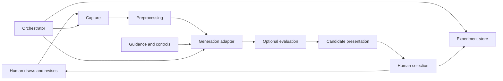

# Architecture guidance

Status: implemented through T07, with the decisions recorded in the ADRs linked below. These choices implement the proposal and are not additional requirements from it.

## Boundaries

[The call graph](call-graph.html) shows how the implemented modules call each other, from the browser UI down to the files on disk. Open it in a browser.

The orchestrator records all stage inputs, effective configuration, outputs, errors, and timing, not just generation. The UI invokes application operations and does not own model logic or persistence.

| Planned boundary | Responsibility | Replaceability rule |
| --- | --- | --- |
| `domain` | Serializable contracts and identifiers | No camera, model, UI, or tracking SDK imports |
| `capture` | Acquire image plus capture metadata | File/synthetic source for tests; real camera adapter for delivery |
| `preprocessing` | Named, configurable image transformations, and the fixed-size paper canvas and its strokes for guided sketching | Retain input and transformation provenance; no generation calls |
| `generation` | Capabilities, request validation, candidate generation | Backend-specific objects stay inside adapters |
| `backends` | Package holding each backend in its own module (`fake`, `diffusers`, and `t2i_adapter`, which subclasses the diffusers backend), whose `describe()` tells the person what runs | Backends are registered by name in `components` |
| `stroke_suggestion` | `StrokeSuggester` base class and its request, part, suggestion, and output records for next-stroke suggestions | Separate from generation and prompt suggestions, and shares `control_issues` with the generator contract |
| `stroke_suggesters` | Package holding each next-stroke suggester in its own module, the labeled `fake` and the img2img `controlnet` one, with `line_parts` extracting new parts from a line drawing with OpenCV only | Suggesters are registered by name in `components`, and the ControlNet one reuses the diffusers backend's model sources and loading helpers but owns its own pipeline |
| `components` | Map setting names to generation backends, capture sources, preprocessors, evaluators, stores, and stroke suggesters | The CLI and UI build components only through it, while library callers inject objects directly |
| `settings` | Read the optional `sketchloop.toml` or `--config` file and apply flag overrides | Standard library only; validates shape and types, while `components` checks names |
| `evaluation` | Optional scoring/filtering of candidates | No hidden human-selection decisions; preserve original candidates |
| `follow` | `FollowDetector` base class and `AlignedStrokeFollowDetector`, which aligns each capture of a guided drawing to the open suggestion's baseline canvas and finds new strokes, with OpenCV only, plus the alignment records | Injected into `GuidedDrawing`; never loads a model, and records a failed alignment instead of raising |
| `evaluators` | Package holding each evaluator that needs a model in its own module (`clip`, with `ClipEvaluator` for the `clip-b32` and `clip-l14` names), whose `describe_scores()` names the model, revision, and meaning recorded with the scores | Evaluators are registered by name in `components`, and evaluator factories receive the whole settings so they find the `[models]` folder |
| `orchestration` | Execute a manual iteration and link it to history, and run a guided drawing (`drawing.GuidedDrawing`) that captures frames, aligns them with the injected follow detector, asks the injected stroke suggester, and draws its overlay | Inject adapters; do not select a provider globally |
| `experiments` | Durable records, artifact integrity, load/replay, including `drawings` for `drawing.json` and experiment names | UI and model adapters do not write storage directly |
| `ui` | Preview, controls, progress, alternatives, selection, history | Use library operations; keep framework types outside domain |

Create modules when their first vertical slice needs them; empty directory trees are not a modular implementation.

## First contracts (task T01)

Use typed records and small abstract base classes that each implementation subclasses ([ADR 0015](decisions/0015-abstract-base-classes-for-components.md)). The interfaces below were first written as protocols. Prefer plain serializable metadata with schema versions.

T01a, implemented, defines `sketchloop.domain`, `sketchloop.generation`, and a labelled fake in `sketchloop.fakes`, now `sketchloop.backends.fake`. See [the T01a design](design/t01a-contracts.md) and [ADR 0005](decisions/0005-domain-records-and-generator-contract.md). Records reference images through `ImageRef`, and bytes stay in transient generation output. `Generator.capabilities` declares supported controls, `validate_request` reports every unsupported setting, and `generate(request, sketch_payload)` returns candidates with adapter-reported effective settings and backend identity. [ADR 0009](decisions/0009-diffusers-backend.md) added the sketch bytes. Selection is an explicit event limited to the iteration's candidates. T05 added iteration status and failure records.

Later contracts, each first proposed here and now implemented as noted:

- `CaptureSource.capture()` returns a captured image and metadata (T02). T02 implemented this as the functions `load_sketch_file` and `capture_from_camera`. [The T07 design](design/t07-modularity.md), implemented in T07, adds a `CaptureSource` protocol with `kind` and `capture()`, implemented by `FileCapture` and `CameraCapture` ([ADR 0014](decisions/0014-replaceable-components-and-settings.md)).
- `Preprocessor.process(capture, config)` returns processed image(s) and ordered transformation metadata (T02). T02 implemented this as the function `preprocess_sketch`. T07 adds a `Preprocessor` protocol with `preprocess(payload, rotation)`, implemented by `StrokePreprocessor` and injected into `SketchSession`.
- `Evaluator.evaluate(candidates, payloads, request)` returns scores by candidate ID without mutating candidates, and `NoOpEvaluator` gives none. Implemented in T04 ([ADR 0010](decisions/0010-sessions-and-evaluator.md)). `ClipEvaluator` in `sketchloop.evaluators.clip` scores the cosine similarity between each candidate and the prompt with CLIP ViT-B/32 or ViT-L/14, loaded lazily on the first evaluation ([CLIP note](research/model-clip.md)). `Evaluator.load()`, which does nothing by default, lets `SketchSession` load an evaluator's model before its first scoring and record that time as `model_load` rather than `evaluation`. `Evaluator.describe_scores()` returns the model, revision, and meaning of the scores, empty by default, and each round records it as `evaluation.score_details`. `rerun` maps a round's evaluator and score details back to a registry name with `find_recorded_evaluator` and scores with that evaluator when it can.
- `ExperimentStore` creates/loads runs, stores artifacts, appends iterations and selection events, and reconstructs replay requests. T05 implements this as functions in `sketchloop.experiments` for records, atomic writes, `load_session`, `rebuild_request`, and `compare_rounds`. [ADR 0011](decisions/0011-session-records-and-subcommands.md) defers a replaceable store protocol to T07. T07 adds a write-side `ExperimentStore` protocol injected into `SketchSession`, raising `StoreError` with a one-line message when a save fails, with `FolderStore` as the default and only registered store and `MemoryStore` for tests and library callers. Loading, checks, and rerun comparison stay folder functions.
- An application service runs an iteration and records explicit selection separately. Candidate IDs must belong to the iteration being selected. T06 implements `sketchloop.app.AppController`, which never imports gradio, and a thin `sketchloop.ui` Gradio module that calls it ([the T06 design](design/t06-ui.md), [ADR 0012](decisions/0012-gradio-ui-and-input-source.md)).
- Stage timing and hardware, implemented in T08 ([the T08 design](design/t08-latency.md), [ADR 0017](decisions/0017-stage-timings-hardware-and-benchmark.md)): `CaptureSource.capture()` returns a `CapturedSketch` with its own capture time, `GenerationOutput` reports a backend's model load time, `ExperimentStore` has `save_files` so saving is timed, and a `sketchloop benchmark` subcommand summarizes repeated rounds through the unchanged `SketchSession`.

Define failure types for capture unavailable, invalid image, unsupported configuration, backend failure/timeout, and persistence failure. Keep an incomplete run visible as failed; never label partial output complete or overwrite the previous successful iteration. Retry creates a new attempt linked to the original.

## Practical defaults and pending decisions

Start locally, with one user and manual triggering. The filesystem store with versioned JSON records stays the store, and the Gradio page stays the UI, until the revisit triggers in [ADR 0016](decisions/0016-keep-gradio-page-and-folder-store.md) apply, such as queries across many sessions. SQLite or an external tracker can then be added behind the store interface. Do not require MLflow merely because it appears in the references.

OpenCV, Diffusers, and Gradio were adopted for capture and processing, generation, and the local UI ([ADR 0008](decisions/0008-opencv-for-image-input.md), [ADR 0009](decisions/0009-diffusers-backend.md), [ADR 0012](decisions/0012-gradio-ui-and-input-source.md)), and [ADR 0013](decisions/0013-default-dependencies.md) records how they are installed. Record further dependency decisions and compatible versions in ADRs.

The first model decision must cover sketch conditioning, visual quality, supported guidance, memory/latency, local versus remote execution, availability/version pinning, license, and replay limits. Known hardware: a Windows laptop without a GPU, a laptop or USB webcam, and possibly a GPU or Colab later. Keep the generator interface usable both in-process and against a remote runtime such as Colab. Do not choose a paid provider on behalf of the researcher. Contracts, synthetic fixtures, and offline orchestration can proceed while this remains open.

## Expansion seams

Preserve explicit iteration identity and stage timing now so later streaming work can add scheduling, cancellation, backpressure, and stale-result suppression. Do not build a streaming service before the manual baseline works. Additional evaluators, models, and presentation modes should reuse the same core. Formal multi-user support and participant identity systems are deferred. The user study ([ADR 0021](decisions/0021-guided-sketching-and-user-study.md)) adds a suggestion component beside the generator, behind its own abstract base class, and a study mode that identifies participants only by pseudonymous codes. [The T09 design](design/t09-guided-sketching.md), accepted with [ADR 0025](decisions/0025-drawings-as-the-unit-of-guided-sketching.md), names that component `StrokeSuggester` in a new `stroke_suggestion` module, with a fake and an img2img ControlNet implementation in a `stroke_suggesters` package, adds a `follow` module that aligns captures and scores whether a suggestion was followed, and adds a `drawing` orchestrator that `SketchSession` and `AppController` use. The interface, the fake and ControlNet suggesters, the paper canvas, the `[stroke_suggester]` and `[drawing]` settings, and the registry entries exist. Slice 5 adds named experiments (`SketchSession(name=...)`, claimed through `ExperimentStore.claim_session`), the drawing records and `ExperimentStore.save_drawing` and `locate_drawing`, `GuidedDrawing` with suggestions, overlays, and finishing, and the controller operations `start_drawing`, `suggest_strokes`, `preview_guided_sketch`, `finish_drawing`, `latest_drawing`, and `describe_stroke_suggester`. `sketchloop ui` creates the configured stroke suggester and warms it up in the background. Slices 7 and 8 add `GuidedDrawing.record_capture`, which keeps interval frames as JPEG at quality 90 while press and finish frames stay PNG, `AppController.record_drawing_capture`, which saves one when at least 0.8 of the save interval has passed and turns away concurrent calls, and the alignment half of follow detection in `follow.py`: the `FollowDetector` base class, injected through `SketchSession.start_drawing` and `AppController`, and `AlignedStrokeFollowDetector`. Per-part scores, windows, decisions, the page's capture timer, and `show` are not built yet.
